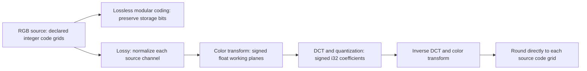

# Source precision and transform headroom

`ImageInfo::with_significant_bits(&[r, g, b, a])` declares the right-aligned
integer code range of each stored channel. Supply exactly the image's channel
count. U8/U16/U32/I32 (and, since 2026-10-08, I8/I16/U64/I64) declarations
accept every width from one through the storage width; floating samples
retain their full F16/F32/F64 representation. U8/U16/U32 have integer lossy
coding; I8, I16, I32 and the 64-bit types remain lossless-only
([SAMPLE_TYPES.md](SAMPLE_TYPES.md)). Zero is an internal/public
field shorthand for full storage width, not a zero-bit sample type.

```rust
# fn example() -> Result<(), imij::Error> {
let mut info = imij::ImageInfo::new(1920, 1080, imij::Channels::Rgba, imij::SampleType::U16)
    .with_significant_bits(&[10, 12, 13, 1])?;
info.cicp = imij::Cicp::BT2100_PQ;
# Ok(())
# }
```

Lossless coding preserves **every storage bit**. Declaring ten significant bits
never silently discards padding or floating-point payloads. Exact per-channel
mapping detection can compact shifted, replicated, scaled, or offset values
without changing those storage bits. A declaration does not force a mapping.
Signed declarations are informational in the lossless path; signed lossy coding
is not implemented.

Lossy integer coding requires every input sample to lie in its declared range,
including alpha, and rejects out-of-range samples. It normalizes each source RGB
component independently **before** color conversion, and rounds reconstructed
RGB directly to each component's declared code grid. It does not first round to
full16 and then round again. Gray uses its one source precision for all three
working lanes. Alpha remains separately lossless. No truncation option is
implicit in this API; callers choosing a smaller range must explicitly convert
their samples first.

Custom ranges require full-range RGB CICP (matrix 0). Custom color ranges in
XYB require a supported sRGB, PQ, or HLG transfer; YCoCg works on normalized code values. An alpha-only
declaration retains the existing full-width color path. This does not
convert primaries, interpret ICC, or infer light units from a bit depth. Existing
U8/U16/F16/F32 paths retain their previous format and arithmetic. U32 lossy
always requires full-range RGB CICP, including at full storage width. Its XYB
path requires a supported sRGB, PQ, or HLG transfer.

## Reversibility

Source precision, color-transform headroom, and coefficient precision are three
separate quantities. Integer lifting YCoCg-R applied to N-bit unsigned RGB needs
N-bit unsigned Y and N+1-bit signed Co/Cg: 8-bit RGB requires both signed 9-bit
chroma values. Those extra ranges must survive coding for exact reversal.



An integer YCoCg-R representation would carry its own N+1-bit chroma ranges;
those internal ranges would not change the original RGB source declaration.

For that unaltered lifting transform, 6,641,088 of the 16,777,216 RGB8 inputs
(39.584%) require Co or Cg outside signed 8-bit range. The exact
[range census](../experiments/hdr_precision/headroom.py) counts every input;
it is not an estimate of photographic frequency. Simply clipping or wrapping
those chroma values while retaining the original lifting equations corrupts
colors. A deliberately designed modular transform is a different reversible
mapping, and reducing chroma precision is a separate lossy decision.

The current lossless codec uses reversible modular residual decorrelation, not
YCoCg-R. Its exactness therefore does not require storing two explicit ninth
bits. Current lossy YCoCg keeps signed floating-point chroma and fractional
intermediates until quantization; it does not mask chroma to eight bits.
Quantized coefficients use signed i32 with the existing validated magnitude
limit. Declaring a source range does not narrow those coefficients.
High-quality HDR can require a 32-bit nested DC stream even for a 10-bit source.
That requires the existing `extended` feature, which is enabled by default;
baseline-only builds reject such an encode explicitly.

XYB does not acquire an integer reversibility guarantee by allocating extra
bits. The current exhaustive RGB8 color-only audit recovers all 16,777,216
colors, but U16 HDR counterexamples lose precision before DCT. See
[EVAL_COLOR_PRECISION_2026-10-04.md](EVAL_COLOR_PRECISION_2026-10-04.md) for
separate color, transfer, DCT, and quantization diagnostics. These tests are
arithmetic evidence, not photographic RD or throughput measurements. Exact
storage remains a lossless guarantee.

## Signaling and compatibility

Declarations use the header's `sig_bits` field (SPEC section 1.0, present
bit 2): one byte per channel, 1 through storage width; floats must use the
full width. Full-storage images omit the field in the masked form. Malformed
widths are rejected before image allocation.
Nested DC keeps its own precision; nested alpha inherits the source alpha bits.
Frame/page channel precision must match its canvas declaration.

Plane indexes likewise distinguish version-1 advisory precision from version-2
precision bound to each native tile component. Full-storage new plane sets
remain version 1. Old files retain their original interpretation. See
[PLANES_AND_ROI.md](PLANES_AND_ROI.md) for named channels and seekable levels.

## Implementation and validation

Bit counts are runtime parameters; there are no per-bit-depth kernels. The
existing portable SIMD transfer and YCoCg kernels share const-generic
full-storage/custom-range implementations. Full-storage branches compile away
inside those kernels. Custom input transfer tables share storage between
components with equal precision and remain bounded by three 65,536-entry tables for U8/U16. U32 evaluates the input
transfer analytically in normalized f64 units before entering the existing f32
working planes. Its inverse uses the fixed 5,633-entry transfer interpolation
table and rounds directly to U32, without an intermediate U16 grid. Table memory
does not grow with a U32 source range.

U32 storage and declared ranges up to 32 bits do **not** imply 32 effective bits
of lossy precision. The f32 color/DCT pipeline, transfer interpolation and
quantization limit reconstruction precision. Values around 2^24, 2^31 and
u32::MAX are accepted without integer overflow; exact low-order color bits
remain a lossless guarantee. Alpha retains all its original bits independently.

Tests cover all U8/U16 depths, U32 boundaries and mixed declared ranges,
independently sized channels, HDR transfers,
alpha, odd geometry and byte strides, scalar/SIMD tails, threaded and streaming
parity, malformed declarations, full-width byte compatibility, and lossless
preservation of storage bits outside an advisory range. Real HDR compression
and the high-speed policy study are evaluated separately; these correctness
tests alone do not establish competitive HDR RD or performance neutrality.

The U32/row extension passes 249 all-feature tests (three existing ignores),
strict workspace Clippy, and 19 new integration tests under both scalar and
SIMD128 WASI. Five no-default precision tests include explicit rejection of
U32 encoding without the existing extended feature. [Validation receipts](../experiments/u32_rows/validation.json)
retain the initial test-isolation and lint failures as well as corrected runs.
