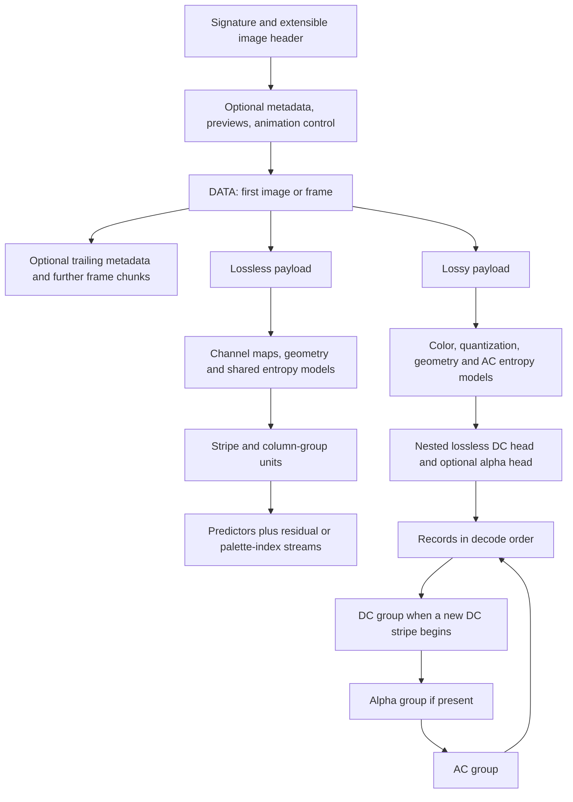
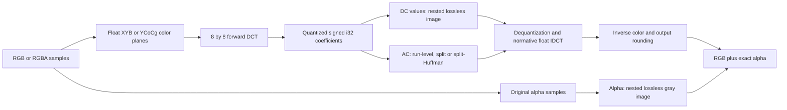
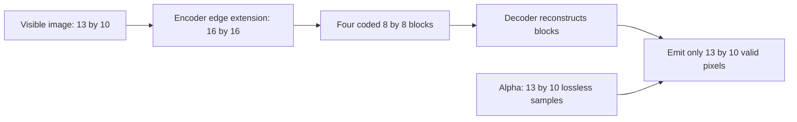
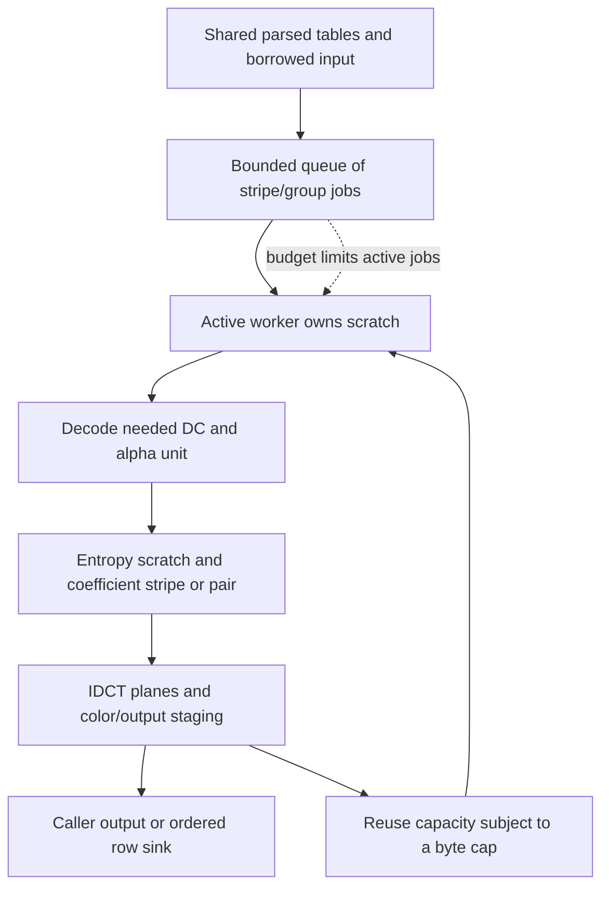

# Stream, color precision, alpha and work buffers

Source inspection: 2026-10-03. This describes the implementation, including
known distinctions from a future simplified format. See [SPEC](../SPEC.md),
[LOSSY](LOSSY.md), [numerical precision](NUMERICS.md), and
[the matrix harness](BENCH_MATRIX.md).

## Container and pixel streams



The outer lossless/lossy choice is separate from the lossy AC entropy choice.
Run-level is the surviving rANS mode; split-Huffman uses Huffman for side
information and the same raw magnitude/sign bits the retired split mode
defined. Its DC and alpha still use the lossless engine. Packed rANS
(wire value 1) and split rANS (wire value 2) are retired and reserved:
decoders reject them as `Unsupported`.

## Lossy image pipeline



Alpha is already lossless in a lossy image: the encoder extracts its original
sample bytes into a nested gray image with the same sample type, full pixel
dimensions and corresponding stripes/groups. It bypasses color conversion,
DCT and quantization. This includes alpha on GrayAlpha and RGBA. Extended
sample support is required for f32 alpha. Exact alpha does not guarantee a
lossy premultiplied color remains <= alpha; that invariant deserves a
specific policy/test. Do not silently clamp color to alpha while claiming
unchanged lossy pixels.

## YCoCg precision: three different operations

The current lossless codec does not perform YCoCg-R. It predicts channel
values, decorrelates the residuals using reversible modular arithmetic,
and codes them without losing bits. Its subtract-green mode is not a
YCoCg transform. The early lab did test YCoCg-R plus a reversible lifting
DCT in a lossless setting: 10.454 bpp estimated on 15 photos versus 9.51 bpp
for predictive lossless (`lift0_lossless` in `lossy_e2_2026-10-01.txt`). That
tests the combined color/DCT design. No isolated comparison of YCoCg-R in
the current predictive lossless codec was located in the ledger or history.

Integer lifting YCoCg-R is:

```text
Co = R - B                 t = Y - floor(Cg / 2)
t  = B + floor(Co / 2)     G = Cg + t
Cg = G - t                B = t - floor(Co / 2)
Y  = t + floor(Cg / 2)     R = B + Co
```

For RGB8, Y is 0..255 and both chroma components are -255..255. Each chroma
coordinate therefore needs a signed 9-bit container if represented directly.
That does not imply a fixed two-bit-per-pixel entropy penalty: the set of
reachable triples has only 2^24 members and the distributions are correlated.
A lossless implementation must preserve those ranges (or define a different
reversible modular lifting transform), rather than clamp/discard high bits.

The current *lossy* codec instead uses the same lifting-shaped equations
with multiplication by 0.5 and no intermediate floor. Its planes are f32:
Y can have quarter steps, Co is integral and Cg can have half steps. These
values are exactly representable for RGB8. It does not narrow Co/Cg to u8.
After the DCT, quantized values are signed i32; AC magnitudes support up to
22 bits and nested DC uses U16 or I32 as required. RGB8 is produced only
after inverse transform, inverse color, clamping and rounding.

`ycocg_rgb8_exhaustive` exercises the actual dispatched color kernel and the
normative inverse over all 16,777,216 RGB8 triples, without DCT/quantization.
The native test passed with zero loss. This is a color-stage test, not a claim that the
lossy codec reconstructs every image exactly. Quantization, the transfer
function and final output precision need separate gradient/banding tests.

For scale, a separate enumeration of integer YCoCg-R finds 6,641,088 RGB8
triples with at least one chroma coordinate outside signed eight-bit range
[-128,127]. That is a hypothetical narrowing failure, not a current codec
failure. The effect of clipping, wrapping, or dropping a low bit differs;
there is no universal “number of lost colors” without specifying that rule.

Float is a pipeline choice, not a requirement of YCoCg. An integer front end
could compute the same fractional transform exactly in fixed point before
converting to the float DCT. Replacing it with rounded integer YCoCg-R would
change the transform and inverse semantics; simply changing the storage type
would not preserve the existing format. The current encoder is already SIMD
float, so integer arithmetic is not automatically faster end to end.

The DCT decision also needs a precise scope. E1 compared float DCT with a
reversible lifting DCT. At low internal precision the lifting version lost
substantial compression at matched quality; four fractional bits brought it
close to float. That does not reject an ordinary non-reversible fixed-point
DCT, and no such production comparison was located. A fixed-point forward
DCT can still emit the existing integer coefficient syntax for the float
decoder. An integer inverse is a different question: the current float IDCT
and its operation order are normative, including HDR and wide coefficient
ranges. A replacement must reproduce those outputs or define a new contract.
The recorded lifting study is not evidence that float is universally fastest.

## Why the current float IDCT is fast

The inverse uses a factored AAN transform; the forward transform now uses
AAN too. Each 8-point inverse pass needs five multiplies
and 29 additions/subtractions. Sixteen passes make an 8x8 inverse: 80
scalar-equivalent multiplies, plus 64 coefficient dequantization multiplies.
The AAN scale and normalization are precombined with the quantization steps;
there is no separate normalization pass or runtime trigonometry.

`lossy/simd.rs` runs eight independent columns/rows in SIMD lanes, with
register transposes between passes. `lossy/recon_v4.rs` packs two adjacent
blocks into AVX-512 vectors. Its transposes operate independently in each
256-bit half. The same f32 operation order is retained, without FMA.

DC-only blocks use a flat fill instead of the transform. In the AVX-512
paired kernel this shortcut requires both blocks to be flat; a mixed pair
runs both through the transform. Reconstruction clears coefficients as it
consumes them, maintaining the reusable scratch buffer's zero invariant.
IDCT and color conversion alternate in chunks of 32 blocks, with about
25.5 KiB of intermediate planes including padding. Plane rows have 64 bytes
of padding to avoid the recorded 4 KiB address-aliasing stalls.

These are concrete implementation advantages, not proof that float beats a
well-designed fixed-point inverse. The E10 Zen 4 profile attributed 16% of
decode cycles to IDCT. The earlier Zen 5 two-file stage measurements showed
roughly 0.93-1.39 ms for AVX-512 versus 1.17-1.45 ms for AVX2, depending on
file/run; the much larger whole-decoder difference also included color and
entropy changes. See E7/E10 in [LOSSY](LOSSY.md) and
[`lossy_zen5_idct_sb_2026-10-02.txt`](../benchmarks/lossy_zen5_idct_sb_2026-10-02.txt).
A useful integer experiment must compare identical coefficients, sparse
block distributions, output types, rounding guarantees and full decode cost.

## Identity RGB mode

An identity color mode could pass R/G/B planes directly to DCT/quantization.
It would still be lossy. The three-plane AC machinery and lossless alpha can
be reused, but the wire needs an explicit color ID and specified inverse,
scales, quantization defaults and HDR/code-value meaning. Existing decoders
must reject the new ID. Gray handling and frame keep semantics also need
tests; do not label identity planes as XYB/YCoCg.

This idea was tested in the lab on 15 photos at 1024 pixels. Identity RGB was
24-72% larger than zenjpeg at matched SSIMULACRA2; other metrics were worse.
Those numbers are relative to zenjpeg, not relative to current IMI, and do
not cover all content. See `lossy_rgb_vs_transform_2026-10-02.txt` and E12.
The small cost of YCoCg makes identity a weak general speed/size candidate.
It remains possible for a special-purpose profile if a concrete workload
justifies it; the experiment is not a structural incompatibility.

## Partial blocks, frames and crops



The header stores exact visible width/height. The encoder replicates the
last pixel/row into the right/bottom DCT padding; the decoder clips emission
to visible dimensions. No separate crop rectangle is needed for a 13x10 or
1x1 image. Padding still affects the boundary block's coefficients.

Frame chunks additionally store x0/y0 and a nested image with its own exact
size, so a changed rectangle can start at an arbitrary pixel and need not
be 8-aligned to the canvas. Its DCT grid is local to the rectangle. This is
not arbitrary crop metadata for a larger still image, and there is no public
ROI decode API. Groups permit coarse horizontal selection; entropy decoding
within a selected unit and boundary IDCT blocks may still be necessary.
Lossless pixels in a rectangle and lossy pixels from an independently
encoded rectangle have different exactness guarantees because block edges
can move. Frame rectangle validation also has the audit defects to fix.

## Worker memory and recomputation



This is the recommended ownership design, not a claim that every existing
driver already implements it. The current drivers build job descriptors and
use different thread/scratch strategies. Sharing a thread pool does not
bound scratch retained by several concurrent image decoders.

Measure the maximum simultaneous live allocation sum, plus retained memory
between images. A scratch buffer freed between phases can reduce peak;
keeping it for reuse can overlap it with another phase's buffers. Re-decoding
a small DC unit can be better than retaining a whole decoded DC image. A
future self-tracker should use shared byte accounting and RAII ownership of
actual capacities. Neither summing per-worker peaks nor taking their maximum
gives the process peak. Validate a self-tracker against heaptrack first.
Use an owning buffer wrapper to record reserve/grow/drop events and keep the
budget attached when buffers move between workers. Track capacity, not length.
Call the result accounted buffer capacity: allocator overhead, fragmentation
and transient old/new storage during reallocation still need external checks.

## Making encoding faster

The October 3 encoder changes replace the dense forward DCT with an AAN
factorization, simplify source-row deinterleaving, and reuse one channel's
coefficient buffer. The forward transform now needs 80 scalar-equivalent
multiplies plus 64 normalization multiplies per block, versus 1024 before.
Normalization remains a separate operation to avoid changing quantization
rounding again. FMA is used in two rotations where the backend supports it.
A second measured change skips empty chunks in lossless channel presence
tables, which were a major cost of encoding tiny nested DC images.

Final production builds measured a 9.1% median throughput gain across 36
roughly 1 MP image/color/quality/thread configurations on Zen 4, and 48.3%
across 72 cases at 64×64. These are the combined changes: the initial profile
spent more cycles deinterleaving input than transforming it. See the
[benchmark report](../benchmarks/encoder_aan_2026-10-03.md) for the corpus,
all size buckets, rate–distortion curves and unchanged process peak memory.

Other candidates, in order of concrete source evidence:

1. Reuse per-worker plane/coefficient buffers; avoid copying every coefficient
   into new allocations when forming column groups.
2. Fuse input deinterleave, edge extension and color conversion where this
   removes passes without increasing register pressure. Avoid a full-size
   temporary alpha copy by feeding an explicit channel view to lossless
   encoding, while preserving the existing common core.
3. Profile repeated coefficient walks: side statistics, histograms, clustering
   and entropy emission. Accumulate reusable statistics during quantization
   where possible. Retaining coefficients versus redoing transform work is
   a memory/CPU policy; do not assume either always wins.
4. Use one pool with worker-owned scratch across transform, nested lossless
   DC/alpha and entropy stages. Avoid oversubscription and per-stripe setup.
5. For lossless, compare effort=5 (the previous fast search) with default=10.
   See [the effort measurements](../benchmarks/encoder_effort_2026-10-03.md).
   Then test better bounded
   predictor/decorrelation search and integer YCoCg-R as separate experiments.
   A YCoCg-R experiment needs 9-bit chroma support throughout the prediction,
   model, palette and output path; compare against today's complete codec,
   not only isolated channel entropy estimates.

Use the matrix harness for initial profiles and real-corpus matched-quality
validation. The earlier SIMD encoder optimization already delivered a recorded
2.4x gain; merely proposing SIMD again is not a new optimization.
Benchmark a non-reversible fixed-point forward DCT alongside a factored float
one before declaring either the faster implementation for the desired sample
types. A fast RGB8-only path and a shared HDR path have different maintenance
costs; include that cost in the subset decision.
