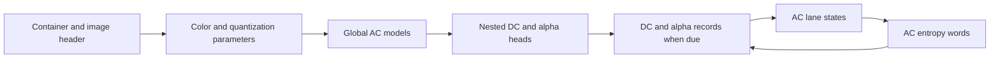

# Reversible byte-overhead experiments, 2026-10-04

These are lab representations, not a production format change or a decoder
speed result. They reconstruct the original ZQI file byte for byte, preserving
its previously verified decoded pixels. The Python wrappers allocate complete
files; they do not demonstrate a streaming implementation or a native memory
budget. The production format and defaults remain unchanged.

## What is being measured

The framing inspector accounts for every byte of a closed, single-image RGB8
or RGBA8 lossy file: container; lossy parameters; global AC models; nested DC
and alpha fields/models; record lengths; RunLevel lane states; AC payload; and
DC/alpha records. DC record bytes are not further classified as entropy versus
restart overhead. The inspector rejects metadata/animation, open DATA,
unsupported sample types, and Packed/Split entropy modes. It is a framing
inspector, not a replacement for the production semantic/entropy validator.



Header experiments pack the first four boxes. State omission packs the lane
states. Record lengths, unchanged bytes and all new wrapper fields are charged.

AC tables are global per image, not per stripe. At 1024 pixels wide and tall,
RunLevel carries 16 four-byte states per stripe: 8,192 bytes with eight-pixel
stripes, or 1,024 bytes with 64-pixel stripes. The first photo at q0 has a
285-byte prefix, 8,192 bytes of states, and only 30 further AC payload bytes.
This distinction matters more than treating everything as generic headers.

Three header representations preserve everything through the nested DC/alpha
heads, then copy the entropy records unchanged:

1. **Exact presets:** a one-byte reference to a frozen exact byte bundle, with
   length-tagged literal escapes. Bundles include container defaults, geometry,
   channel scales, quantization defaults, and nested DC channel maps. No float
   is rounded or recomputed. Training selected 15 bundles occupying 167 bytes
   including their length prefixes.
2. **Unseeded header LZ:** literals of 1–128 bytes or overlapping copies of
   4–131 bytes with a 16-bit distance; greedy matching considers at most 64
   candidates per four-byte key. This representation needs no shared dictionary.
3. **Seeded header LZ:** the same grammar with an 8,192-byte frozen initial
   history, assembled deterministically from distinct 32-byte training-header
   pieces. This tests premade byte-history seeding, not pretrained ANS models.

Every external-dictionary wrapper includes its eight-byte signature, method,
eight-byte dictionary identifier, original/coded prefix lengths, compressed
prefix, and original records. If it would not shrink the original complete
file, the original ZQI bytes are the escape representation, without an added
tag. Actual self-contained dictionary wrappers are also encoded and restored:
their dictionary bytes and framing count, and the original-file escape is
applied **after** those costs. Unseeded LZ is already self-contained.

An additional exploratory representation omits a per-file modal restart state:
one transmitted four-byte word, exception bits, and explicit nondefault words.
It charges for all gap lengths, unchanged bytes, lane counts and wrapper
framing. It changes neither probability models nor entropy payloads. A native
syntax could infer some of these locations, but those hypothetical savings are
not counted. This follow-up was motivated by the measured state-byte totals;
it is not an independently preregistered corpus result.

## Corpus and freeze

The input is the previous admitted 28-source study: 7,000 complete ZQI cells,
19 photos and nine graphics sources, with exact encoded/decoded hashes. It
includes the corrected `8029-p3-to-srgb-clipped` rendition, not the earlier
invalid color-tag interpretation. All are previously exposed sources.

Before header evaluation, dictionary training was fixed to families 1407,
2000, 2014, 2024, 8100, 7000 and 9094, at q1/10/40/80, across the ten stored
policies: 280 training files. The remaining 21 families are evaluated separately
(15 photos, two screens, two plots, two illustrations; 5,250 files). No member
of an evaluation family contributes to dictionary selection. This is a
family-disjoint exploratory split, **not an untouched corpus holdout**.

The dictionary, exact training-case list and source hashes are written before
evaluation files are processed. Sizes are measured from actual serialized
wrappers and verified by exact restoration, without consulting quality scores.
These are file-cell medians; qualities and policies are correlated repetitions,
not independent images or evidence for population confidence intervals.

## Header results

Complete-file savings on the 21 evaluation families, including wrapper costs:

| Representation | Median saved bytes | Median file reduction | Maximum saved bytes |
|---|---:|---:|---:|
| Exact presets, shared 167-byte bundle set | 19 | 0.0193% | 25 |
| Unseeded header LZ | 30 | 0.0321% | 349 |
| Seeded header LZ, shared 8 KiB history | 54 | 0.0711% | 373 |

The corresponding photo-only medians are 19/32/56 bytes and
0.0174%/0.0288%/0.0635%. Embedding the dictionary in each file consumes more
than these gains: the real embedded preset/seed wrappers choose original-file
escape for every evaluation file. Shared dictionary storage is a separate
decoder/distribution cost, not free compression.

A separately declared small-image supplement uses center crops of evaluation
families 1415, 8370 and 7060, without resizing or dictionary retraining:
8/16/32/64/128 square pixels, q5/30/60, XYB, RunLevel/SplitHuf, stripe-block
rows 1/8. There are 180 encode/decode-verified cells and three source families.

| Crop width | Median original bytes | Presets reduction | Unseeded LZ reduction | Seeded LZ reduction |
|---|---:|---:|---:|---:|
| 8 | 225 | 6.09% | 12.94% | 20.53% |
| 16 | 274.5 | 4.85% | 12.20% | 17.16% |
| 32 | 415 | 4.25% | 6.48% | 9.57% |
| 64 | 838 | 2.18% | 3.65% | 5.12% |
| 128 | 2291.5 | 0.71% | 0.73% | 1.15% |

Each percentage is the median of the per-file ratios, not the ratio of median
byte counts. Crops from three exposed sources do not establish icon-corpus
performance. They do show that compact defaults deserve separate evaluation
for tiny images, even though they barely affect megapixel photos.

## Repeated restart-state results

All 4,200 RunLevel cells restore exactly. For the unmodified-coefficient XYB
policy, each row below summarizes all 28 source families. File sizes include
the complete state wrapper, explicit locations and masks, with raw escape.

| Quality | Eight-pixel stripes: median bytes saved / file reduction | 64-pixel stripes: median bytes saved / file reduction |
|---|---:|---:|
| 0 and 1 (same clamped quality) | 6840 / 52.64% | 476.5 / 8.18% |
| 5 | 966.5 / 4.54% | 0 / 0% |
| 10 | 0 / 0% | 0 / 0% |
| 20 | 0 / 0% | 0 / 0% |
| 40 | 0 / 0% | 0 / 0% |
| 80 | 0 / 0% | 0 / 0% |

Zero medians do not mean no individual files benefit: at q40, nine of 28
eight-pixel-stripe files shrink, with a maximum of 3,415 bytes. The adaptive
raw escape prevents expansion. This is exact same-file restoration, not a
matched-quality comparison across different quantizers or a production BD-rate
claim. Wider stripes already remove much of the opportunity; the two savings
must not be added as if independent.

This is stronger evidence for compact deterministic/repeated-state syntax than
for a large premade header dictionary in low-rate photos. A production design
should decide whether masks are worth signaling per record or per image, and
measure their parser/branch cost before choosing a canonical representation.

The requested quality bands are also evaluated using the original, hash-matched
decoded pixels and all five inherited metrics. The existing RD analyzer performs
per-image Pareto/log-byte interpolation and integrates only fully bracketed
fixed bands. These are wrapper-rate results, not production decoder BD-rate:

| Photo band | Eight-pixel stripes: reduction, 95% bootstrap interval | 64-pixel stripes: reduction, 95% bootstrap interval | Paired photos |
|---|---:|---:|---:|
| CVVDP FHD 6–8 | 15.95% [10.51, 21.35] | 1.41% [0.57, 2.47] | 16/19 |
| SSIMULACRA2 10–50 | 1.87% [0.49, 3.43] | 0.14% [0.03, 0.30] | 19/19 |

Across all classes the corresponding reductions are 15.00%/1.29% for CVVDP
(22/28 sources) and 4.49%/0.30% for SSIMULACRA2 (28/28). No extrapolation fills
missing support, and there is no per-metric policy oracle. Bootstrap intervals
describe the sampled exposed families, not a decision-grade independent corpus.
The other metric anchors and all per-source results remain in the artifact
analysis. `rd_states.py` reproduces the hash-checked rate/metric join.

This suggests one concrete use: retaining small-stripe working memory while
reducing low-rate state overhead. It does not establish that the wrapper is a
better size/speed tradeoff than wider native stripes; that needs native parsing
and a controlled memory/speed comparison.

## Implementation, limits and validation

The executable research code is in [experiments/overhead](../experiments/overhead).
There are no new Rust dependencies, production APIs, feature flags, or codec
branches. The dictionary-free escape preserves unsupported production files
only when passed directly to `unwrap`; experimental packing intentionally
requires the supported framing subset.

The experimental readers cap files/restored output at 64 MiB, headers at
64 KiB, seeds at 8 KiB, preset counts at 128, state lanes at 16, and varints at
u64. Copies check distance and output bounds; overlapping copies are specified.
Embedded dictionaries cannot recurse. State masks reject unused bits, and all
encoded forms reject truncated fields or trailing framing bytes. Full-image
Python allocations and allocator overhead remain; these limits are not the
production decoder's memory planner.

Tests cover every byte value, overlapping copies, literal boundaries, seeded
and unseeded restoration, preset-prefix ambiguity, self-contained dictionaries,
raw escape, every truncation of sample frames, wrong dictionary IDs, impossible
copies, expansion limits, varint overflow, huge image geometry, unsupported
entropy accounting, state-mask tails, lane counts, and exact state/gap recovery.

```sh
python3 -m unittest discover -s experiments/overhead -v
python3 experiments/overhead/evaluate.py CASES.json PROTOCOL.json NEW_DIRECTORY
python3 experiments/overhead/small_crops.py CASES.json DICTIONARY_RUN FROZEN_COMPARATOR NEW_DIRECTORY
python3 experiments/overhead/evaluate_states.py CASES.json NEW_DIRECTORY
```

Corpus jobs use the shared heavy-work lock. No Python execution times are codec
benchmarks. Scratch artifacts retain frozen protocols, source/dictionary hashes,
per-cell byte accounting, restored-file hashes and complete summaries; the final
artifact pointer [results.json](../experiments/overhead/results.json) identifies
them. The frozen final source matches repository hashes: 12 tests pass, 42,000
header representations and 4,200 state representations restore exactly, and
180 small encode/decode cells pass another 540 header restorations. Earlier
exploratory runs are retained separately; final results use the explicit
self-contained wrapper and final bounds. `plot.py` produces standalone SVG/PNG
figures from the saved summaries.

## What to carry forward

JXL's local encoder source has an `all_default` frame-header bit with an explicit
nondefault path, and chooses prefix coding for tiny or deterministic symbol
groups. Deterministic prefix symbols need no ANS flush state. Those are useful
design patterns for compact bundles and tiny streams. They do not establish
that JXL uses this experiment's premade LZ byte dictionary.

For this codec, prioritize restart overhead and memory-budgeted stripe geometry
for low-rate large images. Keep an explicit tiny-image path on the design list:
compact defaults or unseeded header coding can matter there without requiring
8 KiB of normative dictionary data. A production proposal needs a canonical
grammar, versioning, corruption/resource tests, streaming restoration or direct
parse, decoder-cost measurement, and broader tiny-image coverage before adoption.
