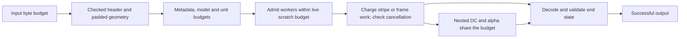

# Hostile and pathological input review

2026-10-03. **The current format can express valid files whose resource use
substantially exceeds their decoded output size. The current `Limits` API is
not a DoS-resistance contract.** Parser fixes remove specific crashes and
ambiguities; an aggregate admission/execution policy is still required.

2026-10-04 update: [decode sessions](DECODE_RESOURCE_POLICY.md) now provide
opt-in cumulative admission and cancellation for serial primary-image slice
decoding. Shared checked parsers charge padded geometry and nested DC/alpha
before reconstruction. The working-capacity plan is not an allocator/RSS cap;
reader, frame and indexed-plane execution still need session policy coverage.
The original measurements and broader requirements below remain historical
evidence and open work where not explicitly superseded.

This review covers source-level bounds, reproduced malformed cases, and
isolated memory probes of valid pathological images. It is not a completed
fuzzing campaign or proof that all decoder paths are bounded safely.

The encoder now has a [decoder-memory planning target](DECODER_MEMORY.md).
It can avoid expensive layouts in newly encoded files; it does not enforce
resource limits on external files or replace the decoder policy described here.

The 2026-10-04 [plane-set API](PLANES_AND_ROI.md) additionally bounds directory
expansion/counts, tile and record bytes, attachment reads and aggregate requested
ROI work before fetching tile payloads. It validates contiguous record ownership,
coherent packed sharing and native tile descriptors. These controls do not turn
ordinary whole-file decoding into an aggregate working-memory guarantee.
[Compressed metadata](METADATA_COMPRESSION.md) has separate serialized/expanded
caps and validates LZ4 syntax before expansion; existing raw metadata policy is
unchanged. Tests cover malformed indexes and tile headers, but neither extension
has yet completed a long-running coverage-guided fuzzing campaign.

## Measured amplification

These files are generated by `imij/examples/resource_probe.rs` and decode
successfully. Each measurement runs a fresh process. Heaptrack counts live
requested heap capacity; RSS is measured separately and may be lower because
zeroed pages need not become resident. The probe includes its input buffer,
output/row storage and process setup. Sizes below use heaptrack's decimal MB.

| Valid file | Input | Output | Peak heap, slice | Implication |
|---|---:|---:|---:|---|
| Gray8 262144×1, lossless, 1 lane, no groups | 83 B | 256 KiB | **42.30 MB** | More than 160× output size; compressed-byte limits alone are ineffective. |
| Same geometry, 16 lanes | 133 B | 256 KiB | 2.98 MB | Physical lane padding is the principal difference. |
| Gray8 262144×1, lossy, no groups | 280 B | 256 KiB | **27.27 MB** | Coefficient/block padding and nested DC also need budgets. |
| Same lossy geometry, 1024-column groups | 35,467 B | 256 KiB | 0.804 MB | Groups reduce the working set, at a framing/size cost. |
| Gray8 256×256, one-pixel units | 524,343 B | 64 KiB | 1.73 MB | Many units increase descriptors and allocation/work overhead. |
| Same image, ordinary units | 332 B | 64 KiB | 0.164 MB | Unit count is a separate resource dimension. |
| One pixel + 8192 metadata chunks | 565,299 B | 1 B | 1.45 MB | Reader retains 524,288 metadata payload bytes despite `max_bytes=256`. |

The one-lane wide case uses about 10.64 MB at width 65,536 and 42.30 MB at
262,144: this is linear amplification, not an exponential decompressor. The
existing 120-megapixel default admits much larger versions; those were not
allocated for this review. Slice, reader and stream all show about 42.3 MB
for the wide one-lane case. Streaming alone does not remove a row's scratch.

For scale, applying the row formula below to a permitted 120,000,000×1 Gray8
image with one coded slot and one lane gives **19.2 GB for those row buffers
alone**, despite only 120 MB of output. This is an arithmetic bound derived
from the implementation, not an attempted allocation or measured peak.

The grouped lossy case also illustrates API differences: reader and stream
peak at 2.66 and 2.26 MB, versus 0.804 MB for slice decode. Retained per-group DC
state and full stripe staging matter, so use the actual execution strategy in
admission estimates.

[All 42 probes](../benchmarks/decoder_hostile_memory_2026-10-03.tsv) and
[provenance](../benchmarks/decoder_hostile_provenance_2026-10-03.json) are saved.
Raw fixtures, logs and heap traces live at
`local-scratch/zqi-hostile-2026-10-03`. Reproduce with the heavy-job wrapper:
build `resource_probe`, run `prepare NEW_DIR`, then use `/usr/bin/time` and
`heaptrack --record-only` separately around `decode FILE slice|reader|stream`.
No timing rankings are inferred from instrumented/build-host runs.

## Why the format permits this

* Lossless physical rows have `16 * ceil(group_width / declared_lanes)`
  positions. `StripeState` holds four such rows per coded slot and one
  additional residual row. U16 storage alone costs
  `2 * (4 * slots + 1) * physical_width` bytes; reference rows, palettes,
  maps, tables and output add to that. One lane can amplify storage/work by
  almost 16 relative to a compact row. Encoder defaults are not decoder bounds.
* Lossy coefficient storage has `64 * channels * block_width * block_rows`
  i32 entries per stripe, plus guards, EOBs, widths/signs and nested images.
  A one-pixel height still occupies a block row. Paired stripes and concurrent
  workers can retain multiple sets. Reconstruction color planes already use
  small chunks; replacing those with full-width planes would worsen this.
* Stripe height and column groups can make unit count approach pixel count.
  The parser's length-byte checks limit malformed descriptor amplification,
  but do not provide a useful application work or allocation-count budget.
* Unknown ancillary chunks, previews and frame descriptors are repeatable.
  Metadata is copied during container parsing, including before some output
  limit checks. The allocating `decode_with_limits` path now retains its
  validated model rather than parsing metadata/models again before reconstruction;
  this does not add a cumulative metadata budget to other entry points.
  Reader `max_bytes` bounds individual reads/allocations, not cumulative metadata.
* Frames may reuse a canvas while demanding many decodes. Repeated empty
  frames are cheap to parse but still require a caller's frame/event budget;
  full frames and pages need cumulative decoded-pixel/work limits. Loop count
  is playback metadata, never permission to do unlimited decoder work.

There are useful structural limits: lossless alphabets are checked at ≤256,
four 1024-slot contexts per model; lossy ANS tables are capped at 32; Huffman
table widths/counts are bounded. Run decoding advances a bounded output
position rather than recursively expanding a run. Lossy DC/alpha heads are
explicitly lossless with derived dimensions: they do **not** recursively
invoke arbitrary lossy images. Gain maps/previews and nested frame chunks are
not automatically traversed recursively by the ordinary pixel decoder.
Applications that traverse them still need cumulative nesting/item budgets.

These observations rule out some obvious unbounded grammar constructions;
they do not prove all arithmetic, padding reads or SIMD state validation safe.
Malformed entropy can fail near the end after doing most of the allowed work.

## Hardening implemented in this working tree

Regression fixtures in `imij/tests/malformed.rs` exercise the real public APIs:

* Shared checked u64 LEB128 reading rejects overflowing tenth bytes. Field
  sizes use checked address-space conversions. Numerically valid overlong
  encodings remain accepted; canonical-varint enforcement is a separate choice.
* Output extent and frame offsets use checked arithmetic. Frame coordinates
  and duration denominators are checked before narrowing. A failed frame
  advance clears the previous current-frame state.
* Palette stripes reject reference predictors 7–9 before backend selection.
* Bounded DATA must be consumed exactly by slice and streaming decoders; the
  reader enforces the declared boundary during reads. Open DATA still uses
  the grammar to delimit its payload. Records crossing a bounded DATA chunk
  are rejected before buffer growth. Callback output is provisional until
  the entire decode returns success.
* Header reserved flags, non-boolean full-range values, non-letter chunk tags
  and late `aNIM` are rejected. Existing ancillary extension behavior remains;
  the reserved third-letter case needs a deliberate compatibility decision.
* Frame color state inherits the canvas. The no_std lossy frame route now
  preserves its reference flag. Nonfinite encoder numeric settings and invalid
  quantization multipliers are rejected. Bit-reader phantom-byte accounting
  saturates instead of wrapping after extensive truncated-input reads.

The shared varint/geometry code is parsing/setup work. Normal streams retain
their bytes and pixels. Combined validation passed 108 release tests, strict
Clippy, all 5,475 frozen fixtures on native/AVX2/full scalar, nine malformed-input
tests in debug and native i686 execution, and seven no_std frame runtime tests.
Two exhaustive predictor gates are explicit runs, already passed separately.
[Validation logs and source hashes](../benchmarks/decoder_validation_2026-10-03.json.pointer.md)
record the tested tree. Paired decoder performance and comprehensive hostile
cross-platform fuzzing remain gates; correctness tests do not establish either.

An encoder-only regression was also caught in review: a proposed forward
zero-run scan repeatedly scanned the same suffix when runs were disabled or
below threshold. It now caches the suffix and skips impossible run searches.
Keep those adversarial settings in performance tests as well as roundtrips.

## Full resource-policy target

Keep output limits separate from working memory. The serial slice policy now
has builders and shares the existing parsers; the full target still requires a
budget shared across an entire request, including metadata, nested
DC/alpha, previews/gain maps chosen by the caller, frames and concurrent workers.

Target enforcement flow (serial slice admission is implemented; broader API
coverage and live scratch ownership remain open):

| Resource | Admission / enforcement point |
|---|---|
| Input bytes, chunk/item count, header/model bytes | Charge before reads, copies or descriptor growth; skip ignored ancillary data without retaining it. |
| Width, height, total pixels/output bytes | Check fixed header before model construction or metadata materialization; use checked padded geometry too. |
| Metadata bytes retained | Cumulative charge, including chunk structs and capacity; distinguish retained payloads from skipped input. |
| Peak scratch/table/index capacity | Estimate from validated layout before allocation; account for active workers, paired stripes, nested DC and retained group state. Use fallible reserve. |
| Total units, frames/pages and nested items | Charge before building lists or invoking another image/frame decode. |
| Work | Charge conservative units at table/stripe/group/frame boundaries, including padded samples and blocks; cancellation/deadline checks at the same boundaries. |
| Concurrency | Bound actual scratch owners across image calls; a per-call thread count does not bound a service's total memory. |

Validate accounting with live-capacity tracking plus heaptrack. Capacity is
charged once to its owner, moves transfer the charge, reuse retains it, and
drop releases it. Sum simultaneously live owners, not unrelated thread peaks.
Account for reallocation overlap and allocator overhead separately. Keep
checks out of inner per-pixel SIMD loops where boundary charging suffices.

When a file exceeds the caller's budget, reject it before the expensive phase
or choose a measured smaller-memory execution strategy. The header's advertised
decode-speed tier is informational and is not evidence that these conditions
hold. An inflation-ratio threshold is also inadequate: perfectly legitimate
flat images compress extremely well, while large metadata can have ratio one.

For an explicitly restricted low-memory profile, bound **physical padded work**,
maximum group/stripe work, unit count and nesting. This can allow fewer lanes
on small groups while excluding enormous one-lane rows. Do not silently change
the general wire format to require today's encoder's lane/group defaults.

Any future LZ77+ANS/LZ4 mode must declare an exact decoded coefficient length
derived from geometry, cap history/dictionary memory and cross-stripe references,
and bound copy work by decoded length. Whole-image dictionary reuse changes
streaming and independent-stripe guarantees; it is part of the format decision,
not just an entropy-coder benchmark detail.

## Remaining validation gates

1. Build an adversarial corpus varying dimensions/aspect ratio, lanes, stripe
   height, group width, table count, sample maps, palettes, maximal AC widths,
   tiny/repeated records, truncated refills, metadata, frame count and keep blocks.
   Store hashes and expected accept/reject outcomes for every API/backend.
2. Run mutation/coverage-guided fuzzing under enforced memory, work, input and
   execution-time budgets. Include stateful stream/frame sequences, cancelled
   callbacks and short/interrupted readers. Minimize failures into regressions.
3. Measure growth over geometric size series and use instruction counts to
   flag superlinear work. Separate cold table setup, steady decoding and cleanup.
   Test debug/release, 32-bit, no_std runtime, WASM, NEON and x86 tiers.
4. Prove budget propagation before offering a bounded/untrusted-input API.
   The current fixes and default `Limits` do not yet provide that guarantee.

Generated study inputs over 50 KB are preserved in the [sealed evidence archive](../benchmarks/final_squash_evidence_2026-10-19.pointer.md). Restore the exact inventory before running commands that use their original paths.
