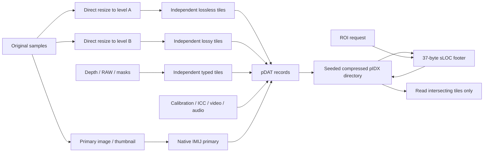

# Named planes, mixed-resolution levels and seeking

Implemented 2026-10-04; experimental and unreleased. The `pIDX` directory is a
record list (introduced in format version 2, 2026-10-10) whose records keep the layouts of
directory version 2 (bound precision, `PLANE_PRECISION.md`); the locator
framing is version 1.

`PlaneSetBuilder` retains the supplied primary image's header version and
writes directory ids for that version: 1/3/5/7 for version 2, 91/93/95/97 for
versions 3 and 4. Independently encoded tiles carry their own header versions.

V4 primary images use a front directory or no directory when plane records are
appended. `PlaneSetBuilder` relocates a supplied tail directory to the front
without changing compressed objects or local digest identities. The explicit
V4 upgrader uses the existing plane finalizer to rebuild all absolute offsets
and the enclosing checksum after converting every image tile. Opaque attachments
and ignorable directory records are retained. V4 image tiles use the ordinary V4
reader and may carry their own final `uIDX`; the plane profile still rejects
metadata, nested plane sets and temporal dependencies. See
[the V4 composition rule](../SPEC_V4.md#11-plane-set-composition).

`imij::planes` adds independently typed, named planes and independently coded
levels around the existing native codec. Ordinary `decode` still returns the
primary image, which may be a thumbnail. `PlaneSetReader` seeks directly to the
directory and fetches only tiles intersecting the requested level and rectangle.
The indexed API does not make an ordinary primary image randomly accessible.



## Data model

| Object | Representation |
|---|---|
| Named plane | UTF-8 name, sample type, significant integer bits, role, units, group, signed registration origin, optional calibration and ICC attachment IDs, CICP |
| Sample types | U8, U16 and F16 in the baseline decoder; I8, I16, I32, I64, U32, U64, F32 and F64 decode with `extended` (lossy levels: U8, U16, U32, F16, F32) |
| Complex plane pair | `ComplexReal` and `ComplexImaginary` planes in one group, lossless (below) |
| Level | Independent width/height, tile width/height, coding, source declaration and contiguous tile-record range |
| Packed color level | Compatible Gray/GrayAlpha/RGB/RGBA components share native tiles and existing optimized color coding; CMYK/Oklab/OklabAlpha use native lossless component tiles |
| Attachment | Opaque named bytes, MIME type, capture group and optional exact rational start/duration |

Lossless levels preserve sample **bit patterns**, including floating-point NaN
payloads, infinities and signed zero. Precision declarations do not discard
storage bits. RAW roles require lossless coding. Color alpha uses the existing
native lossless alpha path even when the color level is lossy.

Each level chooses lossless or lossy independently. Different planes may have
different types, dimensions and level counts. Packed components must agree on
sample type, group, registration origin and color declarations. Use
`decode_color_levels` when their level indices differ; `decode_color_region`
is the convenience form when the indices match.

CICP and ICC are declarations, not automatic conversions. ICC remains an opaque
attachment, and callers must keep it consistent with CICP. Lossy F16/F32 requires
linear-light transfer 8. Lossy U8 XYB requires sRGB transfer 13; YCoCg works on
code values. Auxiliary numerical roles do not acquire display color semantics
merely by having a CICP field. Lossless storage accepts other transfer functions.

Origins locate the first supplied reference grid. Later dimensions do not imply
a pixel-center mapping, scale factor or calibration model. Preserve precise CFA,
lens, distortion, depth and registration metadata in calibration attachments.

## Direct-original multiresolution

The codec accepts explicit reference pixels for each level. It never constructs
one level from another. `OriginalPlane` and `add_level_from_original` provide a
generic callback that receives the same borrowed original and the target
geometry; the builder validates resource limits before allocating or calling it.
The callback selects filtering, color-space and alpha semantics. Resize packed
color and alpha together before adding a shared color level.

Lossless coding then gives exact equality to the selected one-step resize.
Tests use zenresize Lanczos, include fixtures where a cascaded resize differs,
and compare complete decoded levels to direct-original references. Lossy coding
does not promise indistinguishability: quality must be validated against those
references for the intended scale, display and corpus. The `DirectFromOriginal`
flag is a declaration, not proof that arbitrary supplied pixels meet it.

Independent lossy tiles can introduce seams. There are no hidden neighboring
tile dependencies or postfilter halos in this version. Choose tile dimensions
with the access, memory, overhead and quality tradeoff in mind.

## API example

```rust
use imij::{ImiEncoderConfig, SampleType};
use imij::planes::{LevelDescriptor, PlaneDescriptor,
    PlaneRole, PlaneSetBuilder, PlaneSetLimits, PlaneSetReader, Rect, SliceReader};

# fn example(primary: &[u8], depth_native_bytes: &[u8]) -> Result<(), imij::Error> {
let mut builder = PlaneSetBuilder::new(primary)?;
let depth = builder.add_plane(
    PlaneDescriptor::new("camera.depth", SampleType::U16)
        .with_role(PlaneRole::Depth).with_units("mm"))?;
builder.add_level(depth, LevelDescriptor::new(640, 480, 128, 128),
    depth_native_bytes, 640 * 2,
    ImiEncoderConfig::lossless())?;
let file = builder.finish()?;

let mut reader = PlaneSetReader::open(SliceReader::new(&file),
    PlaneSetLimits::default())?;
let mut crop = vec![0; 32 * 24 * 2];
reader.decode_region(depth, 0, Rect::new(100, 80, 32, 24),
    &mut crop, 32 * 2)?;
# Ok(()) }
```

Strides are bytes. Multi-byte sample buffers follow the native-endian convention
of the existing IMI API. `ReadAt` is deliberately implementable by applications:
a file seek adapter, HTTP range reader or Web worker host can supply immutable
random-access bytes without introducing `std` into the codec. `SliceReader` uses
`core + alloc`; `SeekReader` is the small `std::io::Read + Seek` adapter.

The builder currently returns an in-memory complete file. It borrows supplied
level pixels and reuses a tile buffer; the direct-original callback helper also
allocates its complete target level. This is not a streaming encoder sink API.

## Wire format

The existing primary is followed by framed `pDAT` records, one `pIDX` and a final
`sLOC`. All three are reserved ancillary tags and use the ordinary container
chunk framing. `pDAT` is either one complete native tile file or opaque attachment
bytes. Ordinary primary decoding skips these extensions; it does not validate
the directory or all their contents.

`pIDX` contains the bounded seeded pack record described in
[METADATA_COMPRESSION.md](METADATA_COMPRESSION.md). Its expanded directory is
a record list (SPEC.md section 1: `id varint, len varint, payload` each, ids
increasing; an unknown even id is skipped, an unknown odd id is
`Unsupported`, a missing record 91, 93 or 95 is `Corrupt`; files with header
version 2 number them 1, 3, 5 and 7, SPEC Appendix V3). Inside each record
the fields are fixed little-endian integers that fill it exactly; strings are
`u16` byte length plus UTF-8 bytes:

1. Record 91: the primary file's length, a varint.
2. Record 93: `u32 record_count`; each tile record has `u64 offset, u64 payload_length`.
   The offset points to the `pDAT` tag; payload length excludes its tag and
   canonical chunk-length varint. The complete record occupies
   `4 + ULEB128_length(payload_length + 1) + payload_length` bytes.
3. Record 95: `u32 plane_count`; each plane has name, sample/precision/role bytes,
   custom-role text only for role 255, signed `i64 x,y`, `u32 group`,
   `u32 calibration_id`, optional-units flag/text, four CICP bytes,
   `u32 ICC_id`, then a `u32` level count. Missing attachment IDs are `u32::MAX`.
4. Each level (inside its plane, in record 95) has four `u32` geometry values, coding/source/channels/component
   bytes, and `u32 record_start`. Tile count follows from geometry; raster order
   determines the record indices. No redundant per-level vector of record IDs.
5. Record 97, absent when there are none: `u32 attachment_count`; name, MIME text, group/record `u32`, optional-timing
   flag, then `i64 start_num,u32 start_den,u64 duration_num,u32 duration_den`.

Sample, channel and coding values follow the existing native enums. Roles 0–13
are auxiliary, luma, red, green, blue, alpha, depth, disparity, confidence,
portrait matte, segmentation, RAW, complex real part and complex imaginary
part; 255 introduces custom text. Source is 0
for supplied reference and 1 for direct-original. Boolean flags are exactly 0/1.

The 37-byte footer is `sLOC`, canonical chunk-length byte 33, `PSET`,
`u32 version=1`, `u64 index_offset,index_framed_length,total_file_length`.
It permits one tail read followed by the bounded index read. A file with a
`cSUM` checksum (SPEC 1.4) has that chunk in the primary, before its `DATA`
chunk, covering the whole plane set, so records, index and footer keep this
layout and readers without checksums read the file. When the header record
announces the table, `PlaneSetReader` finds it by walking the primary's
chunk framing (a few small reads at open) and checks the pieces that lie
wholly inside every range it fetches; with
`PlaneSetLimits::with_checksum_round_out(true)` it fetches the rest of each
piece a read overlaps, so every byte it uses is verified, and
`with_checksum_verification(false)` skips the table. `PlaneSetBuilder`
verifies a primary's checksum and writes a new table over the plane set.
Physical records
are contiguous and nonoverlapping between the primary and index. Sharing is
restricted to complete coherent color component sets on distinct named planes.
Trailing bytes in a record and noncanonical extension lengths fail
(`Corrupt`). An unknown sample type, role or level coding is `Unsupported` (a
later version may define it); an unknown channel layout, level source or flag
value is `Corrupt` (SPEC 0.3). Directories written before format version 2 (which began with
`PSET` and `u32 version`) are rejected.

## Science records

Calibration, nodata, units, axes, plane coordinates, categories (label and
class planes) and structured metadata for planes ([SPEC.md 1.5](../SPEC.md), guide:
[SCIENCE_METADATA.md](SCIENCE_METADATA.md)) live in one attachment with MIME
type `application/x.imij-science`, written by `PlaneSetBuilder::set_science`
at `finish` and read by `PlaneSetReader::science`. Entries are keyed by plane
ID, with defaults (target 0) that a plane's own records replace tag by tag,
so a z-stack or time series stores its axes once and one `cORD` per plane.
The directory layout is unchanged by it; readers without science support see an
opaque attachment, and a plane set without records gains no bytes. The
records describe samples and never change tile decoding. The descriptor's
free-text units and opaque calibration attachment remain as before.

## Complex planes

Added 2026-10-08 ([Sample types](SAMPLE_TYPES.md#complex-planes)). A complex
array is a plane pair: role 12 (`PlaneRole::ComplexReal`) holds the real
parts, role 13 (`PlaneRole::ComplexImaginary`) the imaginary parts. In each
group there are both or neither; the two share sample type and precision,
level count and level sizes, and their levels are lossless. `finish` rejects
a set that breaks these rules with `InvalidInput`; `open` rejects such a
directory as `Corrupt`. Tiling may differ between the parts.

Store a pair as packed GrayAlpha levels so one native tile holds both parts
and one decode returns NumPy's interleaved complex layout:

```rust
use imij::planes::{LevelDescriptor, PlaneDescriptor, PlaneRole};
# fn example(builder: &mut imij::planes::PlaneSetBuilder, complex128: &[u8]) -> Result<(), imij::Error> {
let [re, im] = [PlaneRole::ComplexReal, PlaneRole::ComplexImaginary].map(|role| {
    builder.add_plane(PlaneDescriptor::new(
        if role == PlaneRole::ComplexReal { "kspace.re" } else { "kspace.im" },
        imij::SampleType::F64,
    ).with_role(role).with_group(1))
});
let (re, im) = (re?, im?);
// complex128 samples: (re, im) f64 pairs, native-endian, 256 x 256.
builder.add_color_level(&[re, im], LevelDescriptor::new(256, 256, 128, 128),
    complex128, 256 * 16, imij::Channels::GrayAlpha,
    imij::ImiEncoderConfig::lossless())?;
# Ok(()) }
```

`PlaneSetReader::decode_color_region(&[re, im], level, rect, out, stride)`
then writes interleaved pairs; `decode_region` on either plane returns one
part. Readers that predate roles 12 and 13 reject the directory (unknown
role).

## Bounds and validation scope

Default `PlaneSetLimits` cap both the packed index payload and its expansion at
4 MiB, planes at 64, total levels
at 1024, records at 1,048,576, attachments at 128 and labels at 256 bytes. Other
defaults are 64 MiB per encoded native tile payload and decoded tile, 1 GiB per
opaque attachment and compressed/decoded request work, 8 GiB per file and one
billion pixels per level. The existing primary also uses the 64 MiB encoded
record cap; opaque attachments use their separate attachment cap. Tile ROI work
counts complete intersected tiles, including encoded record framing, even for
a small crop. Attachment-range work counts only the requested bytes plus bounded
record-header work. Limit setters adjust these bounds;
`new_with_limits` applies them before inspecting a large primary.

Counts are checked against available directory bytes before allocation. Geometry
and offsets use checked arithmetic. Directory ownership prevents aliasing except
valid packed sharing. ROI work sums are admitted before tile reads or output
mutation; only intersecting tiles are fetched. Each fetched tile's native header
must agree with the directory, including type, dimensions, coding and CICP.
Tile orientation is fixed to 1 and stored alpha is straight (opaque/padding
declarations are refused); no undeclared
orientation or alpha conversion occurs. Nested frames, previews and metadata in
native tiles are rejected. Native codec
limits apply as well. Attachment ranges avoid whole-attachment allocation.

These are explicit byte/work bounds, not measured peak RSS guarantees. Decoder
scratch, allocator behavior and caller buffers still matter. A malformed later
tile may fail after earlier output pixels were written; treat output as
provisional until success. `open` validates the index, not all entropy streams or
unrequested records. The source must remain unchanged during use.

Logical 200-megapixel geometry is tested without allocating that raster. Bit
preservation, all 65,536 F16 patterns, mixed levels, non-tight strides, packed
alpha, selective reads, hostile counts/offsets/headers and preflight rejection
are covered by `imij/tests/planes.rs` and internal wire tests.

## Phone capture scope

Named depth/disparity/confidence/matte/segmentation and RAW planes, HDR color
declarations, gain maps in the existing primary, calibration attachments and
timed opaque video/audio allow a capture package to preserve these components.
Vendor DNG/RAW, motion-photo video and unknown metadata can be retained exactly
as attachments. This does not implement every phone's proprietary interpretation,
RAW development, motion-photo demuxing or depth reprojection. Those operations
belong in adapters with their own semantics and conformance tests.


## Native original and pyramid views (V4)

`ImageDirectory` and `ImageView` name an original, reduced levels and previews
without copying existing storage. `ViewBacking::Primary` reuses the primary;
`ViewBacking::Level { plane, level }` reuses a scalar or complete packed-color
backing. View ID zero is valid. The original can be a tiled level while the
ordinary primary remains a thumbnail. `set_image_directory` validates every
reference before replacing the builder's directory.

`PlaneSetReader::image_directory`, `view_info` and `decode_view_region` expose
native discovery and strided, clipped-region output through existing ROI
readers. `primary_header` preserves the primary's stored orientation; these
APIs do not apply orientation, ICC conversion or a resampling transform.
Existing plane ICC/calibration attachments remain authoritative.

`ViewRegistration` maps pixel edges directly to the named original's grid with
reduced rational scales and signed rational offsets. Pixel centers are at
edge coordinate i+1/2. `resized` explicitly declares edge-aligned direct-original
registration when that matches the producer. Omission means unregistered;
the decoder does not infer registration from level dimensions. One original
and direct mappings avoid a recursive view graph.

Wire: optional V4-only critical pIDX record 101; see
[SPEC_V4 section 1.2](../SPEC_V4.md#12-native-image-views). Legacy V2/V3 plane
readers retain their old grammar and reject this critical record. Select `PlaneSetBuilder::set_record_pages` to replace the flat record array
with bounded native record pages (V4 only). Both authorities share this view
discovery contract.


## Paged native directories and forward output (V4)

`PlaneSetBuilder::set_record_pages(n)` selects power-of-two page sizes from 16
through 4096. A fixed locator and bounded root discover page extents; opening
does not fetch or expand every tile descriptor. `PlaneSetReader` retains one
leaf at a time. A cold tile request reads its page and one complete framed
tile; another tile on the retained page needs only its record. These are source
read counts, not measured HTTP roundtrips, latency, browser caching or throughput.
An outer cSUM can require additional verification reads.

Each pREC carries its own ordinal, and each pIPG has a mandatory XXH3-128 check
bound to its ordinal interval and data extent. A selected tile's native header
must still agree with the descriptors. Full validation checks all pages;
sparse access checks selected pages/records. Unread data is never reported as
verified. [The exact grammar](../SPEC_V4.md#13-paged-native-records-and-forward-publication)
uses one offset authority and keeps the existing sLOC layout.

`PlaneSetWriter<W, S>` takes a Write-only destination and caller-owned
Read/Write/Seek scratch. Add planes, declare levels and attachments, and set
native views before publishing the first record. `record_range` supplies each
level's record IDs; `write_tile` accepts an independently encoded native tile,
checks its profile against the declaration and flushes it. It does not verify
all entropy or reconstruct pixels on the producer's behalf. Attachments use
the same physical publication schedule. Tile files must satisfy the existing
native profile; the ordinary Quick plane coder remains unsupported.

After all records are written, `finish` verifies scratch, emits one bounded page
at a time, then pIDX/sLOC. Scratch stores record lengths, not encoded tiles or
pixels; an existing scratch prefix is preserved. Metadata/page-root memory is
bounded separately. Output already flushed is provisional until `finish`
succeeds. Failed publication poisons the writer and prevents finalization.

This forward API currently refuses an enclosing primary cSUM before output;
child checks and mandatory page checks remain available. The buffered builder
retains whole-file cSUM support. A forward complete-file checksum policy and
native browser view integration remain separate gaps.
