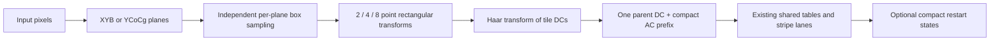

# Subblocks, independent channel sampling, and compact streams

Transforms and sampling are explicit production opt-ins in this experimental
format. Two different representations support 4x4 transforms. Head record 27,
feature `channel_layouts`, describes per-channel transforms and sampling; its
inverse and constants are fixed by the normative `subblock.rs` bundle. Head
record 23, feature `small_transforms` (SPEC 2.11), uses a per-parent joint map
with superblock merges and its own normative butterfly inverse. These records
are mutually exclusive. Record 19 describes near-lossless bounds, not layouts.
Dct2 and independent sampling are available through channel layouts; availability
is not evidence of a corpus RD or native speed advantage.

Compact streams follow the [measured default policy](EVAL_FAST_DEFAULT_2026-10-04.md);
`with_compact_streams(false)` keeps full rANS restart states. The original
0x81 payload was removed on 2026-10-06, and format version 2 dropped the
payload version byte on 2026-10-10.

```rust
use imij::{ChannelSampling as S, LossyChannelLayout as L, LossyTransform as T};
let cfg = imij::ImiEncoderConfig::lossy(50.0).tune_lossy(|t| {
    t.channel_layouts = [
        L::new(T::Adaptive4, S::Full),
        L::new(T::Dct4, S::Full),
        L::new(T::Dct4, S::HalfBoth),
    ];
    t.compact_streams = true;
});
```

Channel order is **Y, X, B−Y** for XYB and **Y, Co, Cg** for YCoCg. Sampling
is independent for each of these three color planes, including the first.
This does not introduce arbitrary extra channels. Alpha retains its original
samples through the existing nested lossless stream. Existing gray/RGB layouts,
U8/U16/F16/F32 input, AQ, stripes, groups, and inter-frame keep blocks compose
with the new geometry. Lab LF prediction and lab RDOQ currently reject changed
layouts because those experiments assume the original coefficient basis.

## Shared parent, different transforms

The coding/scheduling unit remains the existing 8×8 parent. Each color plane
has independent horizontal and vertical sampling flags (full or factor two),
and a maximum transform side of 8, 4, or 2. Rectangular sampled footprints
clip this maximum independently in each axis. Thus half-horizontal plus Dct8
uses a 4×8 transform; full sampling plus Dct4 uses four 4×4 transforms.



Tile DCs use a separable orthonormal Haar hierarchy: four full-resolution 4×4
blocks still have one parent DC, three DC-detail coefficients and 60 ordinary
AC coefficients. Tile ACs are frequency-major, in the existing zigzag filtered
to the rectangular transform size; the DC grid comes first in raster order.
The resulting sequence occupies the first N existing zigzag slots, N =
64 / (horizontal sampling factor × vertical sampling factor). Remaining
coefficients must be zero, and the decoder rejects nonzero unused slots.

Quantizer weights map each tile frequency to its physical frequency in the
8×8 parent and scale by sqrt(transform sample count / 64). DC-detail weights
use their Haar support. The normative implementation and explicit f32 constants
are in `imij/src/lossy/subblock.rs`; inverse passes are columns then rows,
separate multiply/add operations. The full-resolution 8×8 case retains the
original AAN inverse and its normative scaling.

`Adaptive4` compares maximum side 8 versus 4 per parent/channel. It uses
orthonormal coefficient squared error with a common normalization for both
candidates, plus an estimated coefficient-bit cost. This is an encoder
heuristic, not an SSIM2 optimizer or exact global entropy cost. Selection does
not change the plane's sampling. The current sampling choice is per image
channel, not per block. Fixed layouts allow honest separate RD curves.

## Sampling and boundaries

Subsampling averages centered adjacent pairs or 2×2 sample groups. The decoder
uses centered bilinear interpolation, clamped to each parent's sampled edges.
Right/bottom source padding replicates the last actual source sample. Encoded
crop grids start at crop (0,0); input/output byte strides remain explicit.

**Parent-local interpolation can produce sampling seams.** Unlike the earlier
lab chroma420 wrapper, this implementation does not fetch adjacent reconstructed
parent halos. It preserves independent stripe/group decoding and needs no
whole-image sample planes or lookahead. This is an explicit quality tradeoff,
not a claim of equivalence to global triangle interpolation. Full-resolution
subblocks do not use sampling interpolation. No automatic B−Y subsampling
policy has been adopted.

## Lossy payload head (format versions 2 and 3)

All integers described as lengths use the existing unsigned LEB128 varint.
The head starts `stripe_block_rows:u8, group_cols:varint, present:varint,
quant_scale:f32le`, then the fields whose presence bit is set, in bit order
(SPEC.md 2.8; format version 2 replaced the 0x82 version byte, the repeated
color byte and the flag-byte envelope on 2026-10-10; the header's `coding`
names the color):

| Presence bit | Present value | Omitted default |
|---|---|---|
| 0 | Legacy packed seed byte (read compatibility; feature `seed_bank_1`) | No legacy selection |
| 1 | Entropy mode, u8 (3 split-Huffman; 1 packed and 2 split are retired, reserved and `Unsupported`) | 0 run-level |
| 2 | Matrix ID, u8 | XYB: 2; YCoCg: 0 |
| 3 | Three DC step multipliers, u8 each in 1/64 units, nonzero (added 2026-10-06) | XYB: 48, 48, 48 (x0.75 on every plane; 48, 32, 32 before the 2026-10-06 revision); YCoCg: 16, 32, 32 (x0.25 luma, x0.5 chroma) |
| 4 | No field: a head record list follows the entropy tables | No head records |
| 5 | No field: ordinary rANS restart states | Compact restart states (run-level only) |
| 6 | Quantizer floor, f32le | 1 |
| 7 | Three exact color scales, f32le | Color/sample-type defaults |
| 8 | Three channel multipliers, f32le | Color/matrix defaults |
| 9 | Bank ID varint and nonzero scope varint (AC=1, DC=2, alpha=4); feature `seed_bank_ids`, Lossy 0.6 | No new seed selection |

Bits 0 and 9 are mutually exclusive. New seeded encodes use bit 9.

The three channel-layout bytes are head record 27 (default: all
full-resolution Dct8), gated by the feature `channel_layouts` (SPEC 0.1);
the other head records are listed in SPEC.md 2.8.

Quantization steps: position `i` of plane `c` uses
`max(base[c][i] * quant_scale, floor) * multiplier[c]`, and the DC (`i = 0`)
step is then multiplied by `dc[c] / 64` and floored at 1/64.

A layout byte has horizontal/vertical half-sampling in bits 0/1, maximum
transform log2 minus one in bits 2/3 (values 0,1,2), and Adaptive4 in bit 4.
Adaptive4 requires maximum side 8. Bits 5–7 and side code 3 are rejected.
Header exceptions preserve floats exactly; no dictionary, trained presets, or
quality-to-float recomputation is needed by the decoder.

The entropy tables, the head record list, the nested heads and the
interleaved DC/alpha/AC unit records (SPEC.md 2.7) follow. No separate stream is created
for a transform tile or sampled channel.

When any channel is Adaptive4, every AC record starts with a selector map:
`0,constant:u8`, or `1,packed_bytes`. Packed maps hold three little-endian bits
per parent in raster order (one split bit per channel); byte count is implied
by geometry. Unused channel bits and final byte padding must be zero. Fixed
layouts have no map. The decoder borrows the packed map, without allocating
an expanded image-sized selector array.

Compact restart states apply only to RunLevel rANS (presence bit 5 clear
with another entropy mode is corrupt; Packed, which also allowed them, is
retired). Each such
AC record (after any selector map) begins with:

| Tag | Contents |
|---|---|
| 0 | Original active-lane states and entropy payload |
| 1 | Exception bitmap, exceptional states, entropy payload; common state = RANS_L |
| 2 | Common state:u32le, exception bitmap, exceptional states, entropy payload |

Bitmap length is ceil(active_lanes/8); exception states follow in lane order.
All states must be at least RANS_L; unused mask bits must be zero. Entropy
payload length must be even. The encoder chooses the shortest tagged record
and enables compaction only if the sum of complete record lengths, including
maps and record framing, is smaller than ordinary records. Split rANS
and SplitHuf retain their ordinary records while still using compact headers.
The decoder restores at most 16 states on the stack and borrows the unchanged
word payload. Paired AVX-512 entropy decoding remains available for compact-only
files with ordinary full-resolution layouts.

## Seed tables

New seeded files use lossy presence bit 9, feature 28 `seed_bank_ids` and
Lossy profile 0.6. Two canonical unsigned LEB128 values follow the bit-8
parameters: bank ID (1..=u64::MAX), then scope (bit 0 AC, bit 1 DC, bit 2
alpha, nonzero). The bank identity and scope are independent; the ID is a key,
never an allocation count. Unknown banks or scope meanings are Unsupported;
zero, malformed varints or simultaneous presence bits 0 and 9 are Corrupt.

The original Lossy 0.2 form remains readable: presence bit 0 and feature
`seed_bank_1` select one packed byte, bank ID 1..=15 in bits 0–3 and AC/DC/alpha
scope in bits 4–6, with bit 7 zero. New writers use the varint form. Both forms
select the same immutable bank-1 tables; table probabilities do not depend on
decoder software version.

AC selectors require run-level or split-Huffman entropy. Nested DC and alpha
selectors apply to their slot models. The nested exact-block image has no
seed scope: its tables remain explicit.

In a blob with selectors, every table is preceded by one bit. 0: the table
follows in its usual grammar (SPEC 3.3 weights; split-Huffman code lengths,
4 bits per symbol). 1: an index of `ceil(log2 n)` bits follows (0 bits when
n = 1), n the bank's seed count for the table's kind, and the table is that
seed; no table bits follow. An index >= n, or a 1 bit for a kind the bank has
no seeds for, is corrupt. Context maps, table counts and every other field
are unchanged; without a seed selection nothing changes.

Kinds: 0 run-level EOB tables (tables 0..n_eob of the AC blob), 1 run-level
AC tables, 4 split-Huffman count tables, 5 split-Huffman width tables, 6
lossless slot and palette-index tables, keyed by the model's token scheme
(k, m, depth): a lossless seed applies only to a model with exactly that
scheme, so its alphabet matches. A seed decodes exactly as an explicit table
with the same contents (same weight normalization, same canonical codes).

### Bank file layout

The frozen version-1 table asset is a little-endian byte string whose length
is a multiple of 4:

```text
magic     4 bytes  "IMSB"
version   u8       1 (this layout)
bank      u8       bank id, 1..=15
kinds     u8       K
reserved  u8       0
K directory entries, 12 bytes each, in increasing (kind, k, m, depth):
  kind        u8      as above
  k, m, depth 3 x u8  lossless token scheme; 0, 0, 0 for other kinds
  count       u32     n seeds, 1..=256
  offset      u32     byte offset of the kind's section, a multiple of 4
section per kind: (n + 1) u32 offsets relative to the end of the offset
  list, increasing from 0; seed i is bytes [off_i, off_i+1); the section is
  zero-padded to a multiple of 4 bytes.
```

A seed is one table in its kind's grammar, starting byte-aligned, LSB-first:
rANS kinds the SPEC 3.3 weights (`last`, `prec - 1`, exponents, mantissas)
for the kind's alphabet (128 symbols for run-level kinds, the token scheme's
for lossless), split-Huffman kinds 4 bits per code length (17 or 23
symbols). Bank 1 is `imij/src/seeds/bank1.bin`: 27,556 bytes, sha256
`79048930e6eedc048be0dfd752456119bee344dc81dcc863be329b33e293e332`, 963
seeds (run-level EOB 128, run-level AC 255, split-Huffman count 128 and width
64, lossless (4,2,16) 255, (1,2,1) 16, (4,2,15) 32, (5,2,8) 16). Every
decoder has bank 1. A published bank never changes; a new bank gets a new id.

Lab registration additionally accepts a version-2 envelope: `IMSB`, byte 2,
a canonical bank-ID varint, a canonical asset-length varint, then exactly that
many bytes of a validated version-1 asset. This separates logical identity from
the legacy inner header. The registry keeps its bounded 14-entry capacity;
a huge ID does not allocate a huge lookup table. See
[bank IDs and single-pass boundaries](DEFAULTS_AND_SINGLE_PASS.md).

The encoder writes bank 1 selectors by default. Per table it takes the seed
with the fewest estimated coded bits when that, with its index, is cheaper
than the explicit table; it then also codes every seeded blob explicitly,
assembles each seeded/explicit combination and keeps the smallest file, so a
seeded file is never larger than the same encode without seeds. Training and
measurements: `benchmarks/entropy_seeds_2026-10-07/README.md`.

## Outer header

The width-zero compact outer header this document introduced was replaced on
2026-10-06 by the IMI header (SPEC section 1.0): one grammar with a
`present` mask, written in a full form (every field) or a masked form (only
fields that differ from their defaults, the encoders' default). The parameter
defaults address the larger lossy prefix without an external dictionary.

## Memory, portability, validation

Transform scratch consists of fixed stack arrays; const generics share the
rectangular transform implementation. Coefficient buffers still reserve 64
slots per parent/channel for compatibility with the common entropy kernels:
subsampling does **not** currently reduce that allocation. The decoder-memory
planner charges an additional conservative 16 KiB per worker for nondefault
transform scratch. This is a planning allowance, not measured RSS.

Existing row/stripe streaming, column groups, caller Rayon pool, and no_std +
alloc design are retained. No new dependency or Cargo feature is introduced.
New transform kernels are scalar initially; default layouts retain existing
SIMD kernels. Neither native performance neutrality nor a new RD gain is
claimed without measurement.

Tests include independent f64 transform oracles, every impulse and descriptor,
DC/energy/normalization checks, all per-channel sampling/transform combinations,
alpha and padding preservation, 64 input crop origins, public decode API/thread
parity, all entropy modes, AQ/groups, U16/F16/F32, malformed/truncated envelopes,
selector padding, compact state exceptions, and scalar/SIMD hostile-stream parity.

The persisted comparator accepts explicit `experiment: "subblocks-v2"`,
`compact_streams: true|false`, and a three-element `channel_layouts` array with
`transform: "8"|"4"|"2"|"adaptive4"` and
`sampling: "full"|"half-x"|"half-y"|"half-xy"`. Quality extends through 116 only
for that explicit experiment. Earlier configurations retain their original
meaning and reject these fields rather than silently ignoring them.
